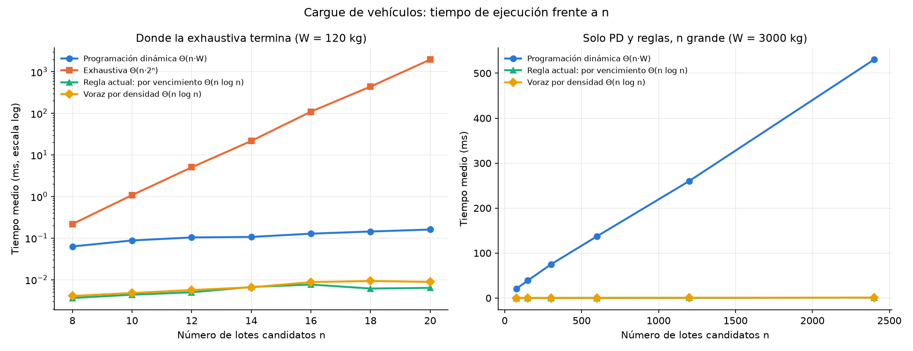
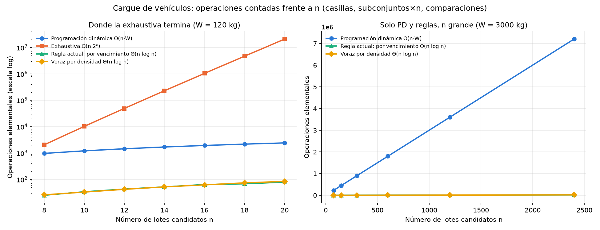

# Proyecto final — Análisis de algoritmos

## Caso 3 — Banco Regional de Alimentos: planeación de despachos

**Curso:** Análisis de algoritmos · 2026-2

**Integrantes**

- David Stiven Franco Lopez
- Juan Sebastian Echeverri Gallego
- Mateo Mesa Cardona
- Julián David Agudelo Acevedo

**Caso asignado:** Caso 3 — Banco de alimentos.

**Operaciones trabajadas**

| Operación | Estado | Estrategias |
|---|---|---|
| 3. Cargue de los vehículos (Laboratorio 4) | Entrega del 18 de noviembre | Programación dinámica (mochila 0/1), exhaustiva, regla actual por vencimiento y voraz por densidad |
| 4. Análisis de saturación de la bodega | Pendiente para el 23 de noviembre | — |

**Contenido**

1. [Análisis del problema](#1-análisis-del-problema)
2. [Diseño de la solución](#2-diseño-de-la-solución)
3. [Implementación](#3-implementación)
4. [Evaluación del desempeño](#4-evaluación-del-desempeño)
5. [Análisis comparativo](#5-análisis-comparativo)
6. [Implicaciones éticas, sociales y ambientales](#6-implicaciones-éticas-sociales-y-ambientales)
7. [Conclusiones](#7-conclusiones)
8. [Referencias](#8-referencias)
9. [Cómo reproducir los datos y los experimentos](#9-cómo-reproducir-los-datos-y-los-experimentos)

---

## 1. Análisis del problema

### 1.1 Descripción del problema computacional

> ⏳ Pendiente para la entrega del 23 de noviembre.

### 1.2 Operaciones críticas del proceso

> ⏳ Pendiente para la entrega del 23 de noviembre.

### 1.3 Costo energético del proceso actual (línea base)

> ⏳ Pendiente para la entrega del 23 de noviembre.

### 1.4 Operación 3 — Cargue de los vehículos: entradas, salida y restricciones

Para cada ruta, el coordinador tiene una lista de lotes candidatos y un vehículo. Hay que decidir qué lotes suben. Lo que tiene de especial es que **un lote no se parte**: o sube completo o no sube. Eso lo vuelve una mochila 0/1.

| Elemento | Descripción |
|---|---|
| **Entrada 1** | Lista de n lotes candidatos de la ruta. Cada lote es una tupla `(peso_kg, valor_nutricional, dias_para_vencer)`. En el caso real n está entre 300 y 600. |
| **Entrada 2** | `capacidad_kg` (W): capacidad máxima del vehículo, entero entre 2.500 y 4.000 kg. |
| **Salida** | El valor nutricional total cargado y los índices de los lotes que suben. |
| **Valor nutricional** | Raciones del lote × prioridad de la categoría. Usamos prioridad 3 para proteína, 2 para frutas y verduras y 1 para otros. |
| **Restricción 1** | La suma de los pesos de los lotes elegidos no puede pasar de W. |
| **Restricción 2** | Un lote no se fracciona ni se repite. |
| **Restricción 3** | El valor tiene que ser **el máximo posible**, no una aproximación (lo pide el cliente explícitamente). |
| **Restricción 4** | Ningún lote vencido se despacha. |
| **Volumen real** | 14 vehículos por día, cada uno con su ruta; ventana de 2 horas (03:00–05:00) compartida con las operaciones 1 y 2; computador de 150 W. |

### 1.5 Operación 4 — Análisis de saturación: entradas, salida y restricciones

> ⏳ Pendiente para la entrega del 23 de noviembre.

### 1.6 Supuestos del equipo

**Operación 3 (cargue)**

- Los pesos son enteros en kilogramos (así lo dice la estructura del lote). La tabla de la programación dinámica tiene una columna por kilogramo; no usamos gramos porque la tabla crecería mil veces sin mejorar la respuesta.
- Todos los lotes pesan al menos 1 kg.
- **Cómo interpretamos la regla actual:** el coordinador ordena los lotes por días para vencer (si dos vencen el mismo día, el que aparece primero en la lista) y los va subiendo uno a uno. **Se detiene en el primer lote que ya no cabe**, aunque detrás haya lotes más pequeños que sí cabrían. Ejemplo: con un vehículo de 10 kg y lotes de 6, 1 y 4 kg en ese orden de vencimiento, suben los de 6 y 1 kg (7 kg), el de 4 kg no cabe y ahí para, aunque quedan 3 kg libres. Así lo entendimos de "carga por orden de vencimiento hasta que ya no cabe el siguiente lote".
- **Voraz por densidad:** ordena por valor/kg de mayor a menor y, a diferencia de la regla actual, si un lote no cabe lo salta y sigue con el siguiente.
- Un lote con 0 días o menos para vencer se considera vencido y ninguna de las soluciones lo sube.
- Si hay empate entre dos cargas con el mismo valor, cualquiera de las dos es válida; la programación dinámica se queda con la que no incluye el último lote evaluado (usa `>` estricto).
- Cada vehículo se resuelve por separado: los lotes candidatos de una ruta ya vienen asignados a esa ruta.

---

## 2. Diseño de la solución

### 2.1 Estructuras de datos seleccionadas

> ⏳ Pendiente para la entrega del 23 de noviembre.

### 2.2 Operación 3 — Cargue de los vehículos

Diseñamos cuatro soluciones para la misma operación: la que proponemos y tres contra las que se compara.

| Solución | Familia | Para qué está |
|---|---|---|
| Mochila 0/1 por programación dinámica | Programación dinámica | **Propuesta**: da el óptimo en Θ(n·W). |
| Exhaustiva | Fuerza bruta | Juez para verificar que la PD sí da el óptimo (solo con pocos lotes). |
| Por vencimiento | Regla actual | Línea base: lo que hace hoy el coordinador. |
| Por densidad (valor/kg) | Voraz | Regla "tentadora" que el laboratorio pide incluir para mostrar que tampoco garantiza el óptimo. |

#### Por qué el problema admite programación dinámica

Decidimos lote por lote si sube o no. Después de decidir sobre el último lote de la lista, lo que queda es **el mismo problema** pero más pequeño: menos lotes por decidir y, si el lote subió, menos capacidad libre. Para describir "lo que queda" hacen falta dos números: cuántos lotes faltan (i) y cuántos kilos quedan libres (w).

- **Subestructura óptima.** Si una carga óptima para los lotes 1..i con w kg incluye el lote i, entonces el resto de esa carga tiene que ser una carga óptima para los lotes 1..i−1 con w − peso_i kg. Si no lo fuera, cambiaríamos ese resto por uno mejor y la carga total subiría, lo que contradice que era óptima. Lo mismo si el lote i no sube: el resto es óptimo para 1..i−1 con w kg.
- **Subproblemas que se repiten.** Muchas combinaciones distintas de decisiones terminan en el mismo estado. Por ejemplo, subir un lote de 6 kg, o subir uno de 4 kg y otro de 2 kg, deja en ambos casos la misma capacidad libre y los mismos lotes por decidir. Un recorrido recursivo resolvería ese estado varias veces; la tabla lo resuelve una sola vez.

Una regla voraz no sirve aquí porque escoger "el mejor lote ahora" puede dejar un hueco que después no se llena con nada útil (lo mostramos con el contraejemplo de la sección 5.1).

#### La recurrencia

Definimos **K[i][w]** = el mayor valor nutricional que se puede cargar usando solo los primeros i lotes en un vehículo de w kg.

```
K[0][w] = 0                                         para todo w   (sin lotes no hay valor)
K[i][w] = K[i-1][w]                                 si peso_i > w o el lote i está vencido
K[i][w] = max( K[i-1][w] , valor_i + K[i-1][w - peso_i] )   si peso_i <= w
```

- `K[i-1][w]`: **no subir** el lote i. La capacidad sigue igual y decidimos sobre los anteriores.
- `valor_i + K[i-1][w - peso_i]`: **subir** el lote i. Ganamos su valor y nos quedan `w - peso_i` kg para los anteriores. Se usa la fila i−1 (y no la i) para que un mismo lote no suba dos veces.
- **Caso base:** la fila 0 (ningún lote) es toda ceros. La columna w = 0 también queda en cero porque no cabe nada.
- **Orden de llenado:** cada casilla de la fila i solo depende de la fila i−1, así que llenamos fila por fila, de arriba hacia abajo. Dentro de la fila el orden de las columnas no importa.
- **Respuesta:** K[n][W].
- **Reconstrucción:** desde K[n][W] subimos fila por fila. Si K[i][w] ≠ K[i−1][w], el lote i subió y restamos su peso a w; si son iguales, no subió.

#### Ejemplo pequeño resuelto a mano

Usamos un vehículo a escala con **W = 10 kg** y cinco lotes, ya ordenados por vencimiento:

| Lote | Producto (categoría) | Peso (kg) | Raciones × prioridad | Valor | Días para vencer | Valor/kg |
|---|---|---|---|---|---|---|
| L0 | Arroz (otros) | 6 | 12 × 1 | 12 | 1 | 2,0 |
| L1 | Atún (proteína) | 1 | 3 × 3 | 9 | 2 | 9,0 |
| L2 | Guayaba (frutas y verduras) | 4 | 8 × 2 | 16 | 3 | 4,0 |
| L3 | Tomate (frutas y verduras) | 1 | 3 × 2 | 6 | 4 | 6,0 |
| L4 | Fríjol (proteína) | 6 | 6 × 3 | 18 | 5 | 3,0 |

Llenamos la tabla fila por fila (la fila i ya considera los lotes L0 a L(i−1)):

| i \ w | 0 | 1 | 2 | 3 | 4 | 5 | 6 | 7 | 8 | 9 | 10 |
|---|---|---|---|---|---|---|---|---|---|---|---|
| 0 (ninguno) | 0 | 0 | 0 | 0 | 0 | 0 | 0 | 0 | 0 | 0 | 0 |
| 1 (+L0: 6 kg, 12) | 0 | 0 | 0 | 0 | 0 | 0 | 12 | 12 | 12 | 12 | 12 |
| 2 (+L1: 1 kg, 9) | 0 | 9 | 9 | 9 | 9 | 9 | 12 | 21 | 21 | 21 | 21 |
| 3 (+L2: 4 kg, 16) | 0 | 9 | 9 | 9 | 16 | 25 | 25 | 25 | 25 | 25 | 28 |
| 4 (+L3: 1 kg, 6) | 0 | 9 | 15 | 15 | 16 | 25 | 31 | 31 | 31 | 31 | 31 |
| 5 (+L4: 6 kg, 18) | 0 | 9 | 15 | 15 | 16 | 25 | 31 | 31 | 33 | 33 | **34** |

Algunas casillas explicadas paso a paso:

- **K[2][7]** (L0 y L1, 7 kg): no subir L1 da K[1][7] = 12; subirlo da 9 + K[1][6] = 9 + 12 = 21. Gana 21 (arroz + atún).
- **K[3][10]** (L0, L1, L2 con 10 kg): no subir L2 da K[2][10] = 21; subirlo da 16 + K[2][6] = 16 + 12 = 28. Gana 28.
- **K[4][10]**: no subir L3 da 28; subirlo da 6 + K[3][9] = 6 + 25 = 31. Gana 31.
- **K[5][10]** (todos, 10 kg): no subir L4 da K[4][10] = 31; subirlo da 18 + K[4][4] = 18 + 16 = **34**. Gana 34.

**Reconstrucción** desde K[5][10] = 34:

1. Fila 5, w = 10: K[5][10] = 34 ≠ K[4][10] = 31 → **L4 sube**. Quedan 10 − 6 = 4 kg.
2. Fila 4, w = 4: K[4][4] = 16 = K[3][4] = 16 → L3 no sube.
3. Fila 3, w = 4: K[3][4] = 16 ≠ K[2][4] = 9 → **L2 sube**. Quedan 4 − 4 = 0 kg.
4. Filas 2 y 1, w = 0: todo es 0 → L1 y L0 no suben.

**Resultado óptimo: guayaba (L2) + fríjol (L4), 10 kg exactos y valor 34.** Este mismo ejemplo está como prueba en `pruebas.py`.

### 2.3 Operación 4 — Análisis de saturación

> ⏳ Pendiente para la entrega del 23 de noviembre.

### 2.4 Cómo reducen el consumo energético las propuestas

> ⏳ Pendiente para la entrega del 23 de noviembre.

---

## 3. Implementación

### 3.1 Tecnologías y herramientas

El proyecto se desarrolló en **Python 3**, utilizando las siguientes herramientas y técnicas:

| Herramienta o técnica | Uso en el proyecto |
|---|---|
| Python | Implementación de algoritmos y pruebas. |
| Programación dinámica | Resolución óptima del problema de mochila 0/1. |
| Fuerza bruta | Verificación mediante evaluación exhaustiva. |
| Estrategias voraces | Comparación de las reglas por vencimiento y densidad nutricional. |
| `random` | Generación de instancias reproducibles con semillas fijas. |
| `time.perf_counter()` | Medición de tiempos de ejecución. |
| Contador de operaciones | Análisis del crecimiento de los algoritmos. |
| Matplotlib | Generación de gráficas comparativas. |
| CSV y JSON | Almacenamiento de resultados experimentales. |
| Git y GitHub | Control de versiones y trabajo colaborativo. |

Los algoritmos se encuentran en `src/cargue_vehiculos/`, las gráficas en `graficas/cargue_vehiculos/` y los resultados en `resultados/cargue_vehiculos/`.

### 3.2 Operación 3 — Código del cargue de vehículos

Los algoritmos y las pruebas están implementados en src/cargue_vehiculos/.

| Archivo | Descripción |
|---|---|
| contador.py | Contador de operaciones elementales. |
| estrategia.py | Solución óptima mediante programación dinámica (mochila 0/1). |
| exhaustivo.py | Solución exacta mediante fuerza bruta. |
| regla_actual.py | Regla por vencimiento y estrategia voraz por densidad. |
| datos.py | Generación de instancias reproducibles para las pruebas. |
| pruebas.py | Pruebas automatizadas, casos límite y 300 instancias aleatorias. |

### 3.3 Operación 4 — Código del análisis de saturación

> ⏳ Pendiente para la entrega del 23 de noviembre.

---

## 4. Evaluación del desempeño

### 4.1 Operación 3 — Complejidad temporal y espacial

Para analizar los algoritmos se utilizan dos variables:

- **n:** cantidad de lotes disponibles.
- **W:** capacidad máxima del vehículo, expresada en kilogramos enteros.

| Algoritmo | Complejidad temporal | Complejidad espacial |
|---|---|---|
| Programación dinámica | Θ(n·W) | O(n·W) |
| Fuerza bruta | Θ(n·2^n) | O(n) |
| Regla por vencimiento | O(n log n) | O(n) |
| Regla por densidad | O(n log n) | O(n) |

**Programación dinámica:** construye una tabla de soluciones para las combinaciones de lotes y capacidades. Su tiempo y memoria dependen de n y W. Es un algoritmo pseudo-polinomial porque W representa un valor numérico, no la longitud de su representación.

**Fuerza bruta:** evalúa los 2^n subconjuntos posibles y comprueba su peso y valor nutricional. Garantiza encontrar el óptimo, pero su crecimiento exponencial impide utilizarlo con grandes cantidades de lotes.

**Regla por vencimiento:** ordena los lotes según los días restantes antes de vencer y selecciona siguiendo ese orden. Su costo está dominado por el ordenamiento, pero no garantiza el máximo valor nutricional.

**Regla por densidad:** ordena los lotes según su valor nutricional por kilogramo. También tiene un costo dominado por el ordenamiento y tampoco garantiza el óptimo cuando los lotes no se pueden fraccionar.

Las mediciones experimentales de las secciones 4.3 y 4.4 permiten contrastar estas complejidades con los tiempos y las operaciones observadas.

### 4.2 Operación 3 — Verificación

Las pruebas están en [pruebas.py](src/cargue_vehiculos/pruebas.py) y se corren con `python -m src.cargue_vehiculos.pruebas`. Cubren:

| Grupo | Qué verifica |
|---|---|
| Casos límite | Sin lotes; un lote que cabe; un lote que no cabe; ningún lote cabe; todos caben; capacidad 0; dos lotes que llenan justo la capacidad; capacidad negativa (debe lanzar `ValueError`). |
| Ejemplo a mano | La PD y la exhaustiva dan 34 con los lotes [2, 4] (guayaba y fríjol) en el ejemplo de la sección 2.2. |
| Contraejemplo | En el mismo ejemplo la regla por vencimiento da 21 y la de densidad 31: las dos quedan por debajo del óptimo 34. |
| Lotes vencidos | Ninguna de las cuatro soluciones sube un lote con 0 o menos días para vencer. |
| 300 instancias aleatorias (semilla 2026) | La PD y la exhaustiva dan **el mismo valor** en las 300 (de 0 a 12 lotes, la guía pide mínimo 20); además la carga reconstruida no pasa de la capacidad, no repite lotes y suma exactamente el valor óptimo; y las dos reglas nunca superan el óptimo ni la capacidad. |
| Trazabilidad | Ninguna solución modifica la lista original de lotes. |

Además, dentro de [medicion.py](src/cargue_vehiculos/medicion.py) hay un `assert` que vuelve a comprobar que la PD y la exhaustiva coinciden en cada tamaño medido. Todas las pruebas pasan.

Una cosa que aprendimos: que la PD coincida con la exhaustiva no prueba que el **modelo** esté bien (si las dos partieran de una idea equivocada, se equivocarían igual). Por eso también está el ejemplo resuelto a mano y los casos límite.

### 4.3 Operación 3 — Pruebas experimentales y resultados

Para evaluar el comportamiento de los algoritmos se implementó el módulo
[medicion.py](src/cargue_vehiculos/medicion.py), que genera instancias
reproducibles, mide los tiempos de ejecución y cuenta las operaciones
elementales de cada solución.

Los experimentos se realizaron utilizando `time.perf_counter()` para
medir el tiempo. La generación de los datos queda fuera del cronometraje
y el conteo de operaciones se realiza por separado.

Se desarrollaron cuatro experimentos:

1. **Tamaños pequeños:** entre 8 y 20 lotes, con capacidad fija de 120 kg.
   Se compararon programación dinámica, fuerza bruta y las dos reglas voraces.
2. **Crecimiento de n:** entre 75 y 2400 lotes, con capacidad fija de 3000 kg.
3. **Crecimiento de W:** 300 lotes y capacidades entre 250 y 8000 kg.
4. **Volumen real del caso:** 10 días simulados, cada uno con 14 vehículos,
   entre 300 y 600 lotes por ruta y capacidades entre 2500 y 4000 kg.

Los resultados se guardaron en
[resultados/cargue_vehiculos/](resultados/cargue_vehiculos/).

**Tiempo de ejecución según la cantidad de lotes**



La fuerza bruta presenta crecimiento exponencial. Con apenas 20 lotes
alcanzó aproximadamente 1957,94 ms, mientras que la programación dinámica
tardó aproximadamente 0,161 ms para el mismo tamaño.

**Conteo de operaciones elementales**



Al duplicar la cantidad de lotes de 10 a 20, las operaciones de la
programación dinámica se multiplicaron por 2, mientras que las de
fuerza bruta se multiplicaron por 2048.

**Tiempo según la capacidad del vehículo**


Al duplicar la capacidad de 2000 a 4000 kg, manteniendo fija la cantidad
de lotes, el tiempo de programación dinámica se multiplicó por 2,17.
Esto es consistente con su complejidad temporal Θ(n·W).

**Calidad de las soluciones**


| Algoritmo | Valor nutricional respecto al óptimo | Capacidad utilizada |
|---|---:|---:|
| Programación dinámica | 100 % | 100 % |
| Regla por densidad | 98,60 % | 100 % |
| Regla por vencimiento | 42,17 % | 86,50 % |

Los porcentajes corresponden a las instancias sintéticas utilizadas
en los experimentos. La programación dinámica garantiza el máximo valor
nutricional, mientras que las reglas voraces no garantizan el óptimo.

### 4.4 Operación 3 — Comparación entre resultados teóricos y experimentales

La programación dinámica tiene complejidad temporal Θ(n·W). Cuando
la capacidad permanece constante, el trabajo aumenta linealmente
con la cantidad de lotes. Cuando n permanece constante, el trabajo
aumenta aproximadamente de forma lineal con W.

| Comparación | Factor experimental de tiempo | Factor de operaciones |
|---|---:|---:|
| PD: 8 a 16 lotes | 2,03 | 2,00 |
| PD: 10 a 20 lotes | 1,83 | 2,00 |
| PD: 300 a 600 lotes | 1,84 | 2,00 |
| PD: 1200 a 2400 lotes | 2,04 | 2,00 |
| PD: capacidad 2000 a 4000 kg | 2,17 | 2,00 |
| Fuerza bruta: 8 a 16 lotes | 503,82 | 512,00 |
| Fuerza bruta: 10 a 20 lotes | 1817,15 | 2048,00 |

Los resultados respaldan el análisis teórico: la programación dinámica
presenta un crecimiento pseudo-polinomial, mientras que la fuerza bruta
crece exponencialmente.

Las diferencias entre los factores de tiempo y operaciones se explican
por los costos de ejecución de Python y las variaciones propias de las
mediciones en el computador utilizado.

### 4.5 Operación 3 — Extrapolación al volumen real y consumo energético

Se simularon 10 días de operación con 14 vehículos diarios.

Para programación dinámica se obtuvo un tiempo promedio de
**1,6684 segundos por día**, considerando las 14 rutas.

La ruta más costosa registrada necesitó aproximadamente 0,2433 segundos,
con 585 lotes y capacidad de 3845 kg.

Estos tiempos representan una fracción muy pequeña de la ventana
disponible de dos horas para la planeación de despachos.

**Comparación diaria**

| Algoritmo | Tiempo estimado por día | Kilogramos despachados por día |
|---|---:|---:|
| Programación dinámica | 1,6684 s | 46.162,5 kg |
| Regla por vencimiento | 0,0030 s | 39.931,9 kg |
| Regla por densidad | 0,0031 s | 46.162,5 kg |

En las simulaciones, la programación dinámica permitió cargar
aproximadamente **6230,6 kg adicionales por día** frente a la regla
actual por vencimiento.

**Estimación de energía**

Para estimar el consumo energético se utilizó un computador de
150 W y 300 días de operación al año.

| Algoritmo | Consumo energético anual estimado |
|---|---:|
| Programación dinámica | 0,02086 kWh |
| Regla por vencimiento | 0,00003755 kWh |
| Regla por densidad | 0,00003877 kWh |

Aunque la programación dinámica requiere más procesamiento que las
reglas voraces, su consumo energético estimado sigue siendo muy bajo
y permite obtener una carga nutricionalmente óptima.

Los resultados dependen de las instancias sintéticas y del equipo
utilizado para las mediciones. No deben interpretarse como mediciones
directas de la operación real del banco de alimentos.

### 4.6 Operación 4 — Complejidad, verificación y resultados

> ⏳ Pendiente para la entrega del 23 de noviembre.

---

## 5. Análisis comparativo

### 5.1 Operación 3 — Contraejemplo de la regla actual (y de la voraz por densidad)

Usamos el mismo ejemplo de la sección 2.2: vehículo de **10 kg** y estos lotes (peso, valor, días para vencer): L0 (6, 12, 1), L1 (1, 9, 2), L2 (4, 16, 3), L3 (1, 6, 4), L4 (6, 18, 5).

**Regla actual (por vencimiento, se detiene en el primero que no cabe):**

| Paso | Lote (por vencimiento) | Peso | ¿Cabe? | Carga | Valor |
|---|---|---|---|---|---|
| 1 | L0 arroz (vence en 1 día) | 6 | sí (6 ≤ 10) | 6 kg | 12 |
| 2 | L1 atún (2 días) | 1 | sí (7 ≤ 10) | 7 kg | 21 |
| 3 | L2 guayaba (3 días) | 4 | **no** (11 > 10) → **para** | 7 kg | 21 |

Resultado: **valor 21, 7 kg (70 % del vehículo)**. Quedan 3 kg libres y todavía estaba el tomate (1 kg), pero la regla ya paró.

**Voraz por densidad (salta el que no cabe y sigue):** orden por valor/kg: L1 (9,0), L3 (6,0), L2 (4,0), L4 (3,0), L0 (2,0).

| Paso | Lote | Peso | ¿Cabe? | Carga | Valor |
|---|---|---|---|---|---|
| 1 | L1 atún | 1 | sí | 1 kg | 9 |
| 2 | L3 tomate | 1 | sí | 2 kg | 15 |
| 3 | L2 guayaba | 4 | sí | 6 kg | 31 |
| 4 | L4 fríjol | 6 | no (12 > 10), lo salta | 6 kg | 31 |
| 5 | L0 arroz | 6 | no (12 > 10), lo salta | 6 kg | 31 |

Resultado: **valor 31, 6 kg**. Metió primero lo "más eficiente" y dejó un hueco de 4 kg que ya ningún lote podía llenar.

**Óptimo (programación dinámica y exhaustiva):** guayaba + fríjol, **10 kg, valor 34**.

| Solución | Lotes | Peso | Valor | Diferencia con el óptimo |
|---|---|---|---|---|
| Por vencimiento (actual) | L0, L1 | 7 kg | 21 | **−13 (−38 %)** |
| Voraz por densidad | L1, L2, L3 | 6 kg | 31 | **−3 (−9 %)** |
| Programación dinámica | L2, L4 | 10 kg | **34** | — |

La regla actual falla por dos razones que se suman: no mira el valor (solo la fecha) y se detiene en el primer lote que no cabe. La de densidad corrige la primera, pero igual falla porque **los lotes no se pueden partir**: si se pudiera llevar media porción del fríjol, la densidad sí daría el óptimo. Este contraejemplo está en `pruebas.py` (`probar_contraejemplo_reglas`).

### 5.2 Operación 3 — Condición contraria: cuándo bastaría una regla voraz

La regla por densidad sería la adecuada (y daría el óptimo en Θ(n log n), sin depender de W) si **los lotes se pudieran fraccionar**, es decir, si se pudiera subir una parte de un lote y recibir la parte proporcional de su valor. Eso es la mochila fraccionaria: se mete lo de mayor valor por kilo y el último lote se parte para llenar justo la capacidad, así nunca queda un hueco. Por ejemplo, si los productos llegaran a granel y se pudieran reempacar en la bodega. También funcionaría una voraz si todos los lotes tuvieran el **mismo valor por kilogramo** (entonces cualquier carga llena es óptima) o si todos pesaran lo mismo (bastaría con escoger los de mayor valor). En el banco ninguna de esas condiciones se cumple: el lote "sube completo o no sube" y los valores por kilo son muy distintos entre proteína, frutas y otros.

### 5.3 Operación 3 — Recomendación

Se recomienda utilizar **programación dinámica (mochila 0/1)** para seleccionar los lotes que se cargarán en cada vehículo del banco de alimentos.

Esta recomendación se fundamenta en los siguientes resultados:

1. **Calidad de la solución:** la programación dinámica garantiza el máximo valor nutricional posible sin superar la capacidad del vehículo y sin dividir los lotes.

2. **Verificación:** las pruebas automatizadas confirmaron que la programación dinámica y la fuerza bruta obtienen el mismo valor óptimo en 300 instancias aleatorias.

3. **Tiempo de ejecución:** en las simulaciones de 10 días y 14 vehículos diarios, la programación dinámica necesitó aproximadamente 1,6684 segundos por día para calcular las cargas.

4. **Aprovechamiento de capacidad:** en las instancias simuladas, la programación dinámica alcanzó un aprovechamiento promedio del 100 %, frente al 86,50 % de la regla por vencimiento.

5. **Valor nutricional:** la regla por vencimiento consiguió el 42,17 % del valor óptimo, mientras que la regla por densidad alcanzó el 98,60 %. Ninguna de las dos garantiza encontrar siempre la mejor combinación.

6. **Viabilidad operativa:** los tiempos medidos se encuentran muy por debajo de la ventana de dos horas disponible para planear los despachos.

Aunque las reglas voraces son más rápidas y consumen menos recursos computacionales, pueden seleccionar combinaciones que desperdician capacidad o reducen el valor nutricional transportado.

Por otra parte, la fuerza bruta garantiza el óptimo, pero su crecimiento exponencial la hace inviable cuando aumenta considerablemente la cantidad de lotes.

**Conclusión:** la programación dinámica ofrece el mejor equilibrio entre calidad de la solución y tiempo de procesamiento para las capacidades y cantidades de lotes evaluadas.

Se recomienda mantener la regla por vencimiento como referencia comparativa y utilizar la programación dinámica como estrategia principal de planificación. Antes de aplicar los resultados en una operación real, se deben validar los datos de inventario, las restricciones de vencimiento y las condiciones logísticas del banco de alimentos.

### 5.4 Operación 4 — Comparación, ventajas y limitaciones

> ⏳ Pendiente para la entrega del 23 de noviembre.

### 5.5 Comparación general y solución seleccionada

> ⏳ Pendiente para la entrega del 23 de noviembre.

---

## 6. Implicaciones éticas, sociales y ambientales

### 6.1 Consumo energético

Para estimar el consumo energético de los algoritmos se utilizó como referencia un computador con una potencia supuesta de **150 W (0,15 kW)** y **300 días de operación al año**.

El consumo se calcula mediante:

**Energía (kWh) = Potencia (kW) × Tiempo de ejecución (horas)**

Los tiempos se obtuvieron de los experimentos realizados con 10 días simulados y 14 vehículos por día.

| Algoritmo | Tiempo estimado por día | Consumo anual estimado |
|---|---:|---:|
| Programación dinámica | 1,6684 s | 0,02086 kWh |
| Regla por vencimiento | 0,0030 s | 0,00003755 kWh |
| Regla por densidad | 0,0031 s | 0,00003877 kWh |

La programación dinámica necesita más tiempo de procesamiento porque evalúa diferentes combinaciones de lotes y capacidades para encontrar la solución óptima.

Las reglas voraces realizan menos operaciones y, por lo tanto, presentan un menor consumo energético estimado. Sin embargo, no garantizan encontrar la combinación de mayor valor nutricional.

En las simulaciones, la programación dinámica obtuvo el **100 % del valor nutricional óptimo**, mientras que la regla por vencimiento alcanzó el **42,17 %** y la regla por densidad el **98,60 %**.

Por esta razón, el mayor tiempo de procesamiento de la programación dinámica se considera aceptable frente al beneficio de seleccionar una mejor combinación de alimentos.

**Limitación:** esta estimación supone una potencia constante de 150 W durante la ejecución. No corresponde a una medición directa del consumo eléctrico del computador ni incluye el consumo energético de los vehículos, la refrigeración o la operación de la bodega.

Los valores se pueden reproducir ejecutando `python -m src.cargue_vehiculos.medicion` y consultando `resultados/cargue_vehiculos/resumen.json`.

### 6.2 Preguntas de impacto del caso

> ⏳ Pendiente para la entrega del 23 de noviembre.

### 6.3 Consecuencias sobre las personas cuando el algoritmo se equivoca o llega tarde

> ⏳ Pendiente para la entrega del 23 de noviembre.

### 6.4 Marco normativo y buenas prácticas

> ⏳ Pendiente para la entrega del 23 de noviembre.

### 6.5 Sostenibilidad de la decisión: escenario de crecimiento

> ⏳ Pendiente para la entrega del 23 de noviembre.

---

## 7. Conclusiones

> ⏳ Pendiente para la entrega del 23 de noviembre.

---

## 8. Referencias

- Cormen, T. H., Leiserson, C. E., Rivest, R. L. y Stein, C. (2009). *Introduction to Algorithms* (3.ª ed.). MIT Press. Capítulos 4.1 (subarreglo máximo), 15 (programación dinámica) y 16 (algoritmos voraces; mochila 0/1 en 16.2).
- Kleinberg, J. y Tardos, É. (2006). *Algorithm Design*. Pearson. Sección 6.4 (Subset Sums and Knapsacks).
- Bentley, J. (1984). Programming Pearls: Algorithm Design Techniques. *Communications of the ACM*, 27(9), 865–873 (origen del algoritmo de Kadane).
- Material del curso: "Fundamentos de programación dinámica", "Estrategia voraz", "Programación dinámica: decidir, verificar y medir" y "Complemento del Laboratorio 4 — Mochila 0/1". Nodo, 2026.
- Documentación de Python: `time.perf_counter`, `random`, `tracemalloc` (https://docs.python.org/3/library/) y matplotlib (https://matplotlib.org/stable/).

---

## 9. Cómo reproducir los datos y los experimentos

Los experimentos de la operación 3 se pueden reproducir utilizando Python 3 y las dependencias del proyecto.

### 9.1 Preparación del entorno

Clonar el repositorio:

~~~powershell
git clone https://github.com/Davdfranco/proyecto-final-banco-alimentos.git
cd proyecto-final-banco-alimentos
~~~

Instalar las dependencias:

~~~powershell
python -m pip install -r requirements.txt
~~~

### 9.2 Ejecutar las pruebas automatizadas

~~~powershell
python -m src.cargue_vehiculos.pruebas
~~~

Las pruebas incluyen casos límite, contraejemplos y 300 instancias aleatorias reproducibles.

### 9.3 Ejecutar los experimentos

~~~powershell
python -m src.cargue_vehiculos.medicion
~~~

El programa compara los algoritmos, mide su crecimiento y simula 10 días de operación con 14 vehículos diarios.

### 9.4 Archivos generados

Gráficas en `graficas/cargue_vehiculos/`:

- `tiempo_vs_n.png`
- `operaciones_vs_n.png`
- `tiempo_vs_capacidad.png`
- `calidad_cargue.png`

Resultados en `resultados/cargue_vehiculos/`:

- `pequenas.csv`
- `grandes_n.csv`
- `capacidad.csv`
- `dias_reales.csv`
- `resumen.json`

### 9.5 Consideraciones de reproducibilidad

Las semillas fijas permiten reproducir las instancias utilizadas.

Los tiempos pueden variar según el computador, el sistema operativo y la versión de Python.

Las mediciones corresponden a datos sintéticos y no representan registros directos de la operación real del banco de alimentos.
